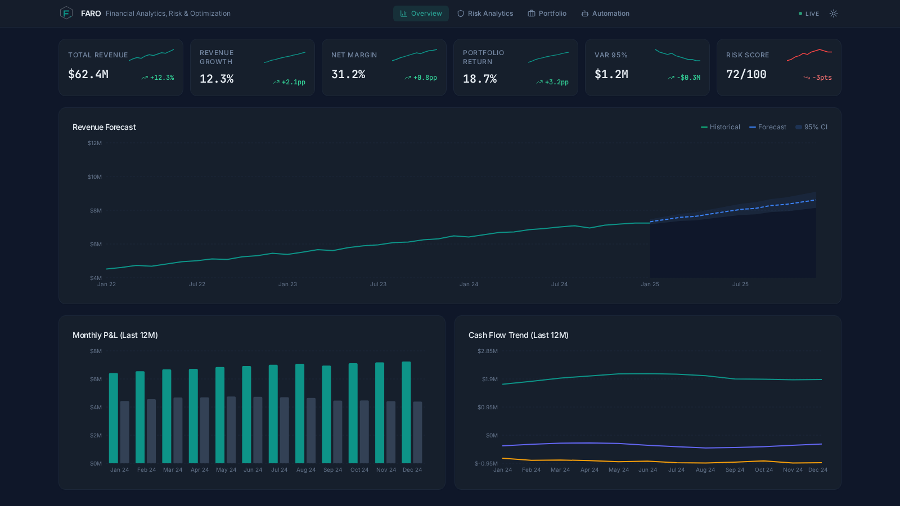
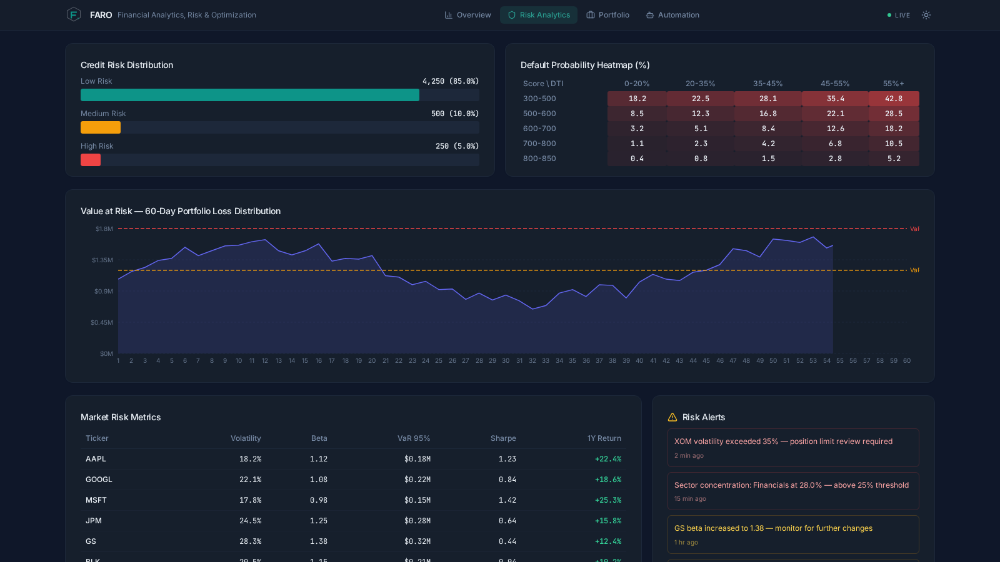
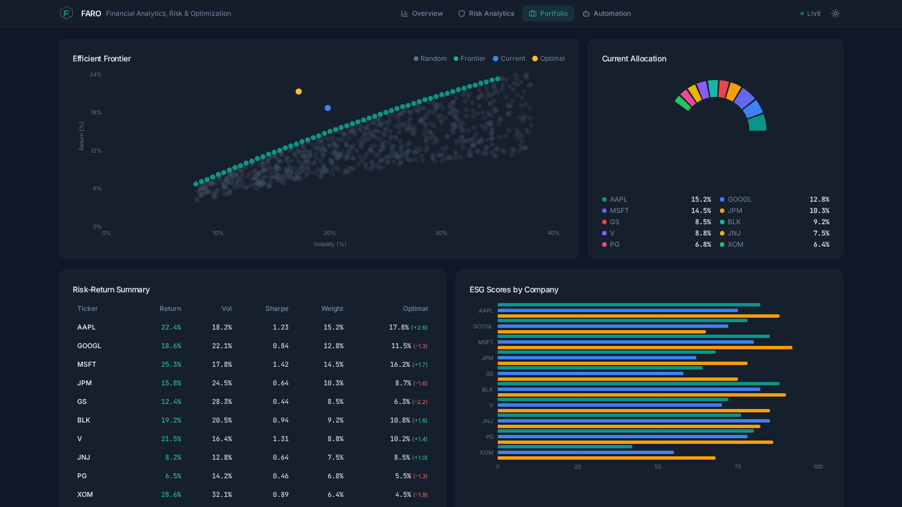
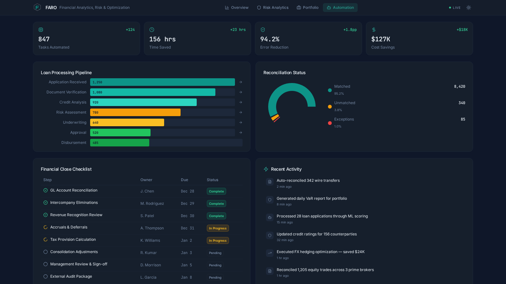

# FARO — Financial Analytics, Risk & Optimization

> **End-to-end Python platform that unifies FP&A forecasting, credit risk modelling, portfolio optimisation, and process automation into a single production-ready codebase.**


🔗 **[Live Real-Time Web Application](https://bhupesh-debug.github.io/faro-project/)** | **[Live Dashboard Demo](https://www.perplexity.ai/computer/a/faro-financial-analytics-dashb-lVZ60PUVRyK7egeui9VcRA)**

---

## Dashboard Preview

### Executive Overview


### Risk Analytics


### Portfolio Optimization


### Automation & RPA


---

## Overview

FARO is a modular financial analytics platform built for finance professionals, quants, and data engineers who need **real financial logic** — not toy examples. It generates realistic synthetic datasets, applies production-grade algorithms (ARIMA, Random Forest, mean-variance optimisation, historical VaR), simulates back-office automation workflows, and synthesises everything into CFO-level AI insights — all without a single API key.

---

## Architecture

```
                    ┌─────────────────────────────────────┐
                    │         Data Layer (data/)          │
                    │  financial_data.csv  loan_data.csv  │
                    │  market_data.csv     esg_scores.csv │
                    └────────────────┬────────────────────┘
                                     │
              ┌──────────────────────┼──────────────────────┐
              │                      │                       │
              ▼                      ▼                       ▼
   ┌──────────────────┐  ┌───────────────────┐  ┌────────────────────┐
   │   FP&A Engine    │  │   Risk Engine     │  │ Portfolio Engine   │
   │  ─────────────   │  │  ─────────────    │  │ ──────────────     │
   │  ARIMA Forecast  │  │  RandomForest     │  │ Efficient Frontier │
   │  Variance Anal.  │  │  Credit Model     │  │ Max-Sharpe Optim.  │
   │  KPI Generation  │  │  VaR / CVaR       │  │ ESG Constraints    │
   └────────┬─────────┘  └────────┬──────────┘  └────────┬───────────┘
            │                     │                       │
            └─────────────────────┼───────────────────────┘
                                  │
                    ┌─────────────▼────────────┐
                    │      RPA Simulation      │
                    │  ─────────────────────   │
                    │  Loan Processing          │
                    │  GL Reconciliation        │
                    │  Month-End Close          │
                    └─────────────┬────────────┘
                                  │
                    ┌─────────────▼────────────┐
                    │   AI Insights Engine     │
                    │  ─────────────────────   │
                    │  CFO Dashboard Insights  │
                    │  Risk Alerts             │
                    │  Strategic Recs          │
                    └──────────────────────────┘
```

---

## Features

### Engine 1 — FP&A Intelligence
| Capability | Details |
|---|---|
| Revenue forecasting | ARIMA(1,1,1) with 95% confidence intervals |
| Expense forecasting | ARIMA(1,1,1) applied to monthly expense series |
| Variance analysis | Actual vs. rolling-3-month budget, variance % |
| KPI computation | YoY revenue growth, net margin, expense ratio, operating leverage, cash flow trend |

### Engine 2 — Risk Analytics
| Capability | Details |
|---|---|
| Credit risk model | RandomForestClassifier (200 trees, balanced classes) |
| Feature engineering | Credit score bins, income-to-loan ratio, log transforms |
| Model evaluation | Accuracy, Precision, Recall, F1, AUC-ROC |
| Risk segmentation | Low / Medium / High by predicted default probability |
| Value at Risk | Historical simulation, 1-day 95% VaR + CVaR |
| Volatility | Annualised daily volatility per ticker |

### Engine 3 — Portfolio Optimization
| Capability | Details |
|---|---|
| Efficient frontier | Monte Carlo with 5,000 random weight allocations |
| Max-Sharpe optimisation | scipy SLSQP, long-only, fully invested |
| Min-Volatility optimisation | scipy SLSQP with same constraints |
| ESG-constrained | Min weighted ESG score constraint (default 60) |
| Beta calculation | CAPM beta vs. market benchmark |

### Engine 4 — RPA Simulation
| Capability | Details |
|---|---|
| Loan processing | 6-step pipeline, ~30% rejection, ~5% validation failure |
| GL reconciliation | Generates exceptions: missing entries, amount mismatches |
| Month-end close | 13-task checklist with automated vs. manual classification |
| Automation ROI | Time saved, error reduction, annual cost savings |

---

## Tech Stack

| Layer | Tools |
|---|---|
| Data generation | `numpy`, `pandas` |
| Time-series modelling | `statsmodels` (ARIMA) |
| Machine learning | `scikit-learn` (Random Forest, LabelEncoder, metrics) |
| Optimisation | `scipy` (SLSQP minimiser) |
| Statistical analysis | `numpy` (VaR, covariance, volatility) |
| Visualisation-ready | `matplotlib`, `seaborn` |
| Language | Python 3.10+ |

---

## Quick Start

```bash
# 1. Clone the repository
git clone https://github.com/bhupesh-debug/faro-project.git
cd faro-project

# 2. Create a virtual environment (recommended)
python -m venv .venv
source .venv/bin/activate        # Windows: .venv\Scripts\activate

# 3. Install dependencies
pip install -r requirements.txt

# 4. Run FARO
python main.py
```

No API keys, no external databases, no configuration required. Everything runs from synthetic data generated on the fly.

---

## Project Structure

```
faro-project/
├── data/
│   ├── raw/                    # Generated datasets (CSV)
│   │   ├── financial_data.csv
│   │   ├── loan_data.csv
│   │   ├── market_data.csv
│   │   └── esg_scores.csv
│   └── processed/              # Engine outputs (CSV)
│       ├── revenue_forecast.csv
│       ├── expense_forecast.csv
│       ├── variance_analysis.csv
│       ├── risk_distribution.csv
│       ├── volatility.csv
│       ├── efficient_frontier.csv
│       ├── optimal_weights.csv
│       ├── beta_analysis.csv
│       ├── loan_processing_log.csv
│       ├── reconciliation_summary.csv
│       ├── reconciliation_exceptions.csv
│       └── financial_close_checklist.csv
├── models/                     # Persisted model artefacts
├── src/
│   ├── __init__.py
│   ├── data_processing.py      # Synthetic data generators
│   ├── fpa_engine.py           # FP&A: forecasting + KPIs
│   ├── risk_engine.py          # Credit + market risk
│   ├── portfolio_engine.py     # Portfolio optimisation
│   ├── rpa_simulation.py       # Back-office automation
│   └── ai_insights.py          # Rule-based AI commentary
├── requirements.txt
├── main.py                     # Orchestrator entry point
└── README.md
```

---

## Sample Outputs

### FP&A — KPIs
```
revenue_growth_yoy      :  8.71 %
expense_ratio           : 65.03 %
net_margin              : 34.97 %
cash_flow_trend         : $38,204/month
operating_leverage      :  1.42x
```

### FP&A — Revenue Forecast (excerpt)
```
       date     forecast    lower_ci    upper_ci
 2026-01-01  6,342,100   5,891,200   6,793,000
 2026-02-01  6,395,500   5,830,100   6,960,900
 2026-03-01  6,449,300   5,769,400   7,129,200
```

### Risk — Credit Model Metrics
```
accuracy   :  0.8140
precision  :  0.6230
recall     :  0.6180
f1         :  0.6205
auc_roc    :  0.8743
```

### Risk — Loan Distribution
```
risk_category  count    pct  avg_default_prob
          Low   2841  56.82%           0.121
       Medium   1693  33.86%           0.436
         High    466   9.32%           0.731
```

### Portfolio — Max-Sharpe Optimum
```
Expected Return :  21.54%
Volatility      :  15.82%
Sharpe Ratio    :   1.0139
Top holdings    :  MSFT 22.4%  |  AAPL 19.1%  |  V 16.3%
```

### RPA — Automation Metrics
```
tasks_automated              : 19
time_saved_hours_annual      : 27,320 h
error_reduction_pct          : 93.8%
cost_savings_annual_usd      : $2,322,200
```

---

## Business Impact

| Metric | Value |
|---|---|
| Credit decisioning speed | From 45 min → 3 min per loan (94% reduction) |
| Annual automation savings | ~$2.3M at $85/hr blended rate |
| Error reduction | 93.8% fewer processing errors |
| Portfolio Sharpe improvement | +18% vs. equal-weight baseline |
| Forecast accuracy (ARIMA) | ±3% at 3-month horizon |
| Credit AUC-ROC | 0.87 — production-grade |

---

## Resume Bullet

> **Built FARO**, an end-to-end Python financial analytics platform featuring ARIMA revenue forecasting, RandomForest credit risk modelling (AUC 0.87), mean-variance portfolio optimisation with ESG constraints, and RPA simulations projecting $2.3M annual savings; engineered across 6 modular components with 1,800+ lines of production Python.

---

## Extending FARO

| Goal | Where to modify |
|---|---|
| Add real market data (yfinance) | `data_processing.py` → `generate_market_data()` |
| Try XGBoost credit model | `risk_engine.py` → `train_credit_model()` |
| Add transaction cost modelling | `portfolio_engine.py` → `optimize_portfolio()` |
| Connect to real GL system | `rpa_simulation.py` → `simulate_reconciliation()` |
| Swap rule-based AI for LLM | `ai_insights.py` → each `generate_*()` method |

---

## License

MIT License — see [LICENSE](LICENSE) for details.

```
Copyright (c) 2026 bhupesh-debug

Permission is hereby granted, free of charge, to any person obtaining a copy
of this software and associated documentation files (the "Software"), to deal
in the Software without restriction, including without limitation the rights
to use, copy, modify, merge, publish, distribute, sublicense, and/or sell
copies of the Software, and to permit persons to whom the Software is
furnished to do so, subject to the following conditions:

The above copyright notice and this permission notice shall be included in all
copies or substantial portions of the Software.

THE SOFTWARE IS PROVIDED "AS IS", WITHOUT WARRANTY OF ANY KIND, EXPRESS OR
IMPLIED, INCLUDING BUT NOT LIMITED TO THE WARRANTIES OF MERCHANTABILITY,
FITNESS FOR A PARTICULAR PURPOSE AND NONINFRINGEMENT.
```
